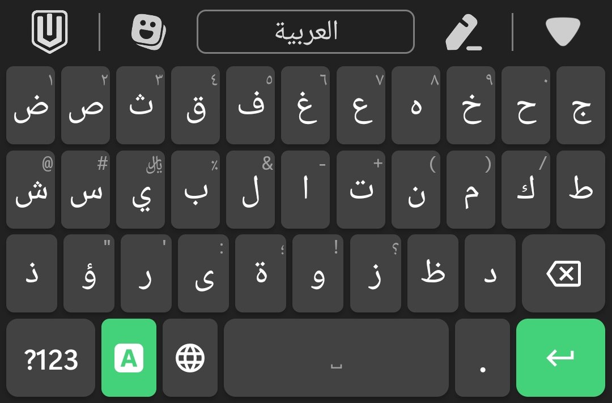
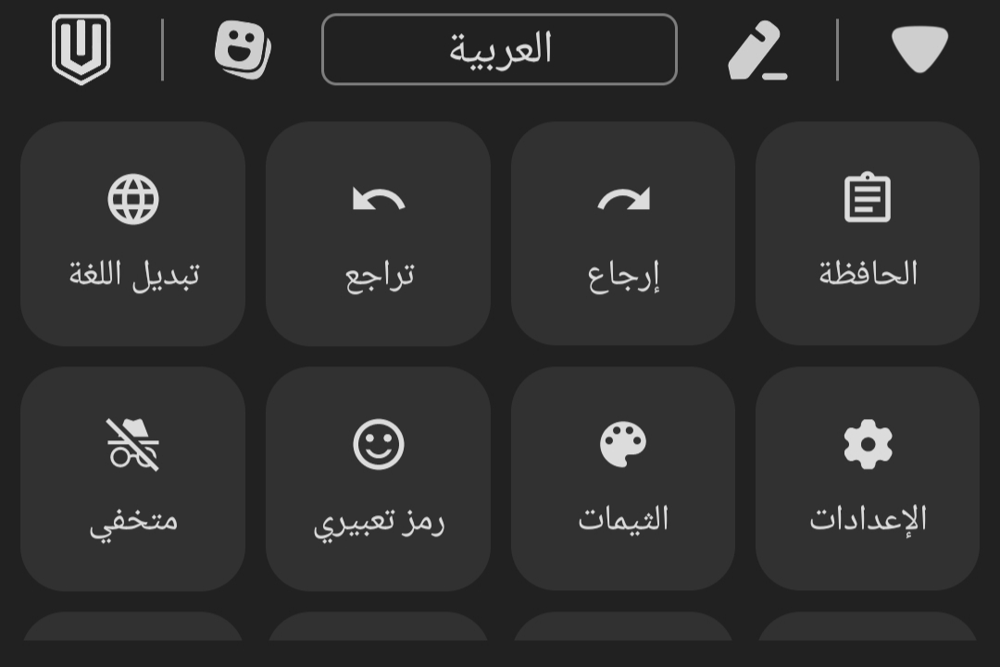
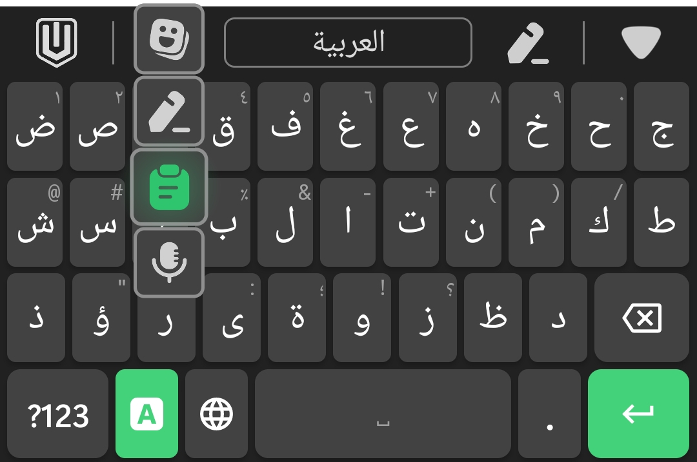
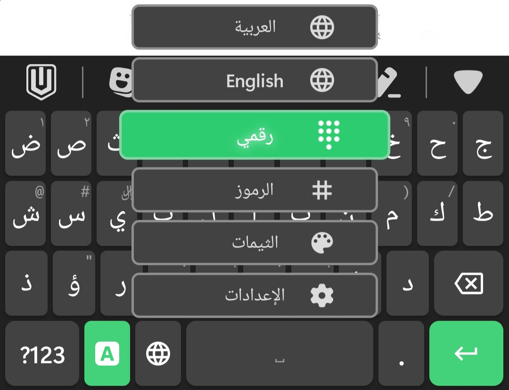

<p align="center">
  
</p>

<h1 align="center">UI Keyboard</h1>

<p align="center">
  <a href="#-العربية">العربية</a> · <a href="#-english">English</a>
</p>

<p align="center">
  
  
</p>

---

## 🇸🇦 العربية

**UI Keyboard** لوحة مفاتيح مجانية ومفتوحة المصدر لأندرويد (8.0 وما فوق)، تدعم العربية والإنجليزية، وهي مبنية على مشروع [FlorisBoard](https://github.com/florisboard/florisboard) ومطوَّرة بواسطة **Khaled Yagami**.

### المميزات
- لوحة مفاتيح عربية وإنجليزية مع التبديل بينهما من شريط الأدوات أو من زر اللغة.
- **اقتراحات الكلمات** بالعربية والإنجليزية، مع توقّع الكلمة التالية.
- **التعلّم من كتابتك**: يتذكّر الكلمات التي تستخدمها، وتبقى البيانات على هاتفك فقط ولا تُرسل لأي جهة، ويمكن مسحها من الإعدادات. لا يتعلّم في حقول كلمات المرور ولا في الوضع المتخفي.
- شريط أدوات سريع: الحافظة وسجل النسخ، تراجع وإرجاع، الرموز التعبيرية، تحرير النص، الإدخال الصوتي، الثيمات، الإعدادات.
- ثيمات جاهزة، ويمكن اختيار صورة من جهازك كخلفية للوحة.
- اختيار خط خاص للوحة المفاتيح (ملفات ttf / otf).
- التحكم في استدارة زوايا المفاتيح.
- تخصيص المفاتيح مع إمكانية إعادة ضبط مفتاح واحد أو جميع المفاتيح.
- الوضع المتخفي.

> **ملاحظة:** اقتراحات الكلمات معطّلة افتراضياً. فعّلها من: الإعدادات ← الكتابة ← عرض الاقتراحات.

### لقطات الشاشة
<p>
  
  
  
  
</p>

### بناء التطبيق (APK)
يُبنى التطبيق تلقائياً على GitHub دون الحاجة إلى حاسوب:
1. افتح تبويب **Actions** في المستودع واختر **Build APK**.
2. اضغط **Run workflow**، وانتظر حتى ينتهي البناء.
3. نزّل الملف من قسم **Artifacts** (`keyboard-debug-apk`) وثبّته على هاتفك.

### التواصل
المطوّر: **Khaled Yagami** — [lightyagami710199@gmail.com](mailto:lightyagami710199@gmail.com)

### حقوق المشروع
UI Keyboard مبني على [FlorisBoard](https://github.com/florisboard/florisboard) من تطوير [مساهمي FlorisBoard](https://github.com/florisboard/florisboard/graphs/contributors)، ومرخَّص بنفس الرخصة (Apache 2.0). قوائم الكلمات المستخدمة في الاقتراحات من مشروع [FrequencyWords](https://github.com/hermitdave/FrequencyWords) وهي بترخيص CC BY-SA 4.0.

---

## 🇬🇧 English

**UI Keyboard** is a free and open-source keyboard for Android (8.0+) with Arabic and English support. It is built on top of [FlorisBoard](https://github.com/florisboard/florisboard) and developed by **Khaled Yagami**.

### Features
- Arabic and English layouts, with language switching from the toolbar or the language key.
- **Word suggestions** in Arabic and English, including next-word prediction.
- **Learns from your typing**: it remembers the words you use. The data stays on your phone only, is never sent anywhere, and can be cleared from the settings. It does not learn in password fields or in incognito mode.
- Quick toolbar: clipboard and history, undo / redo, emoji, text editing, voice input, themes, settings.
- Ready-made themes, plus choosing an image from your device as the keyboard background.
- Choose your own keyboard font (ttf / otf files).
- Adjustable key corner roundness.
- Key customization, with reset for a single key or for all keys.
- Incognito mode.

> **Note:** Word suggestions are off by default. Turn them on in: Settings → Typing → Display suggestions.

### Screenshots
<p>
  
  
  
  
</p>

### Building the APK
The app is built automatically on GitHub, no computer needed:
1. Open the **Actions** tab of this repository and choose **Build APK**.
2. Press **Run workflow** and wait for the build to finish.
3. Download the file from the **Artifacts** section (`keyboard-debug-apk`) and install it on your phone.

### Contact
Developer: **Khaled Yagami** — [lightyagami710199@gmail.com](mailto:lightyagami710199@gmail.com)

### Credits
UI Keyboard is based on [FlorisBoard](https://github.com/florisboard/florisboard) by [The FlorisBoard Contributors](https://github.com/florisboard/florisboard/graphs/contributors), and is released under the same license (Apache 2.0). The word lists used for suggestions come from [FrequencyWords](https://github.com/hermitdave/FrequencyWords) and are licensed under CC BY-SA 4.0.

#### Used libraries, components and icons
* [AndroidX libraries](https://github.com/androidx/androidx) by
  [Android Jetpack](https://github.com/androidx)
* [AboutLibraries](https://github.com/mikepenz/AboutLibraries) by
  [mikepenz](https://github.com/mikepenz)
* [Google Material icons](https://github.com/google/material-design-icons) by
  [Google](https://github.com/google)
* [JetPref preference library](https://github.com/patrickgold/jetpref) by
  [patrickgold](https://github.com/patrickgold)
* [KotlinX coroutines library](https://github.com/Kotlin/kotlinx.coroutines) by
  [Kotlin](https://github.com/Kotlin)
* [KotlinX serialization library](https://github.com/Kotlin/kotlinx.serialization) by
  [Kotlin](https://github.com/Kotlin)

---

## License / الرخصة
```
Copyright 2020-2025 The FlorisBoard Contributors

Licensed under the Apache License, Version 2.0 (the "License");
you may not use this file except in compliance with the License.
You may obtain a copy of the License at

http://www.apache.org/licenses/LICENSE-2.0

Unless required by applicable law or agreed to in writing, software
distributed under the License is distributed on an "AS IS" BASIS,
WITHOUT WARRANTIES OR CONDITIONS OF ANY KIND, either express or implied.
See the License for the specific language governing permissions and
limitations under the License.
```
